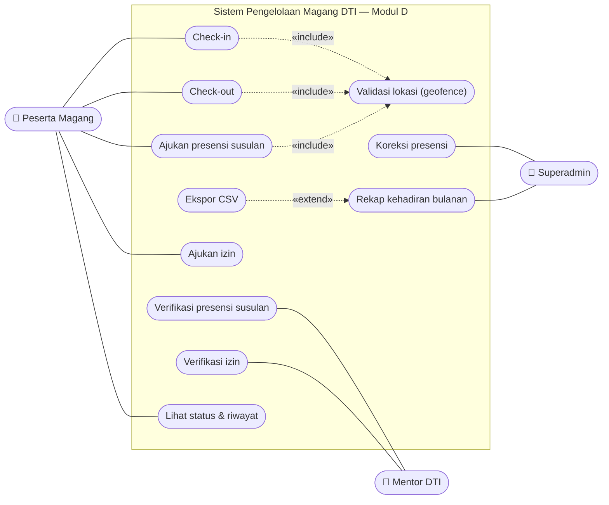
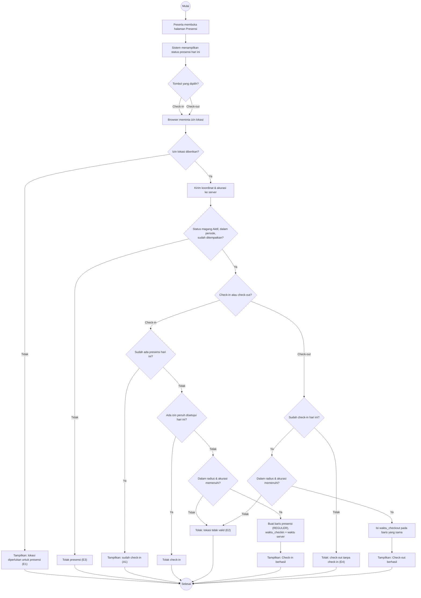
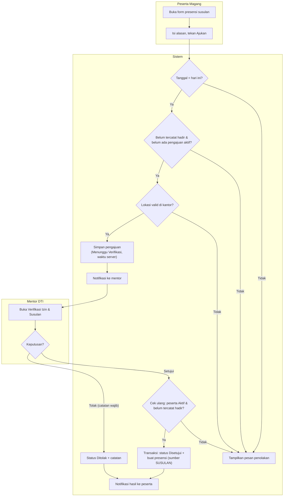
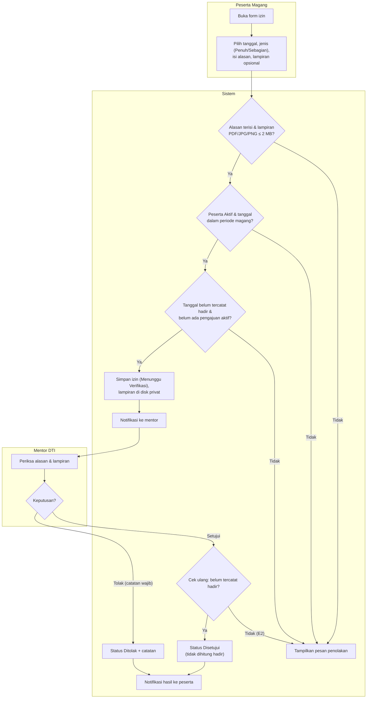
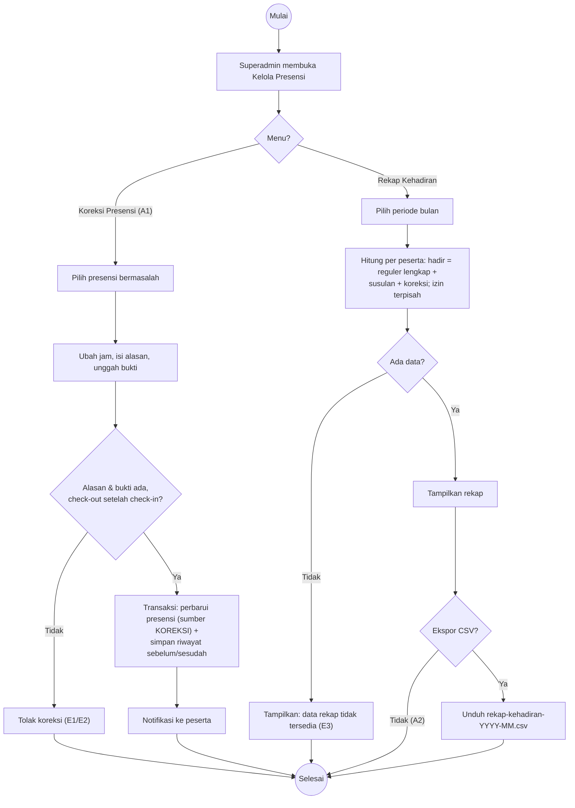
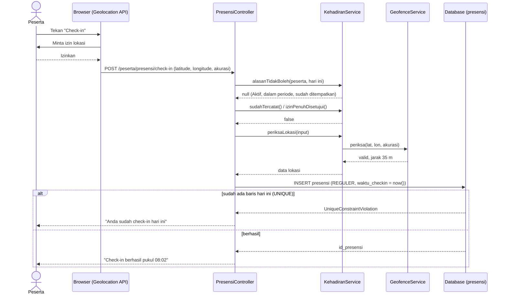
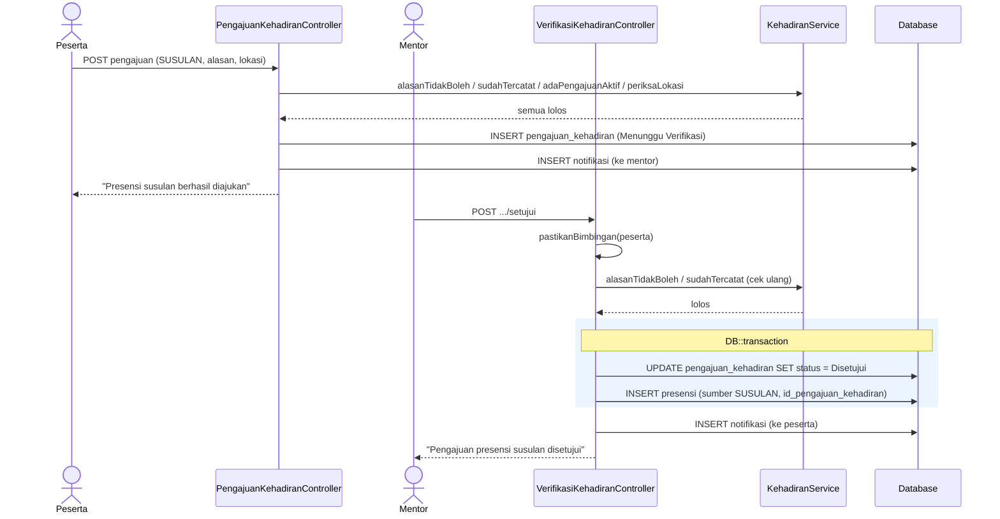
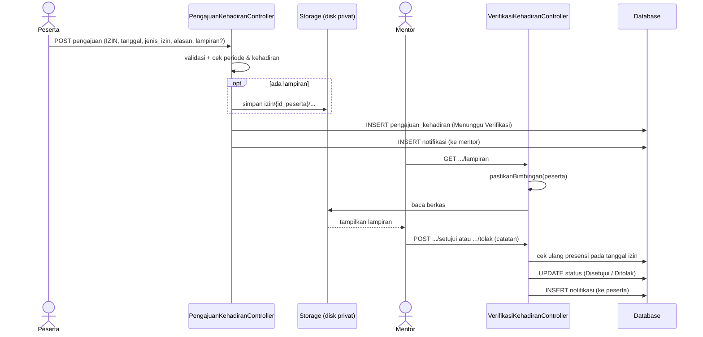
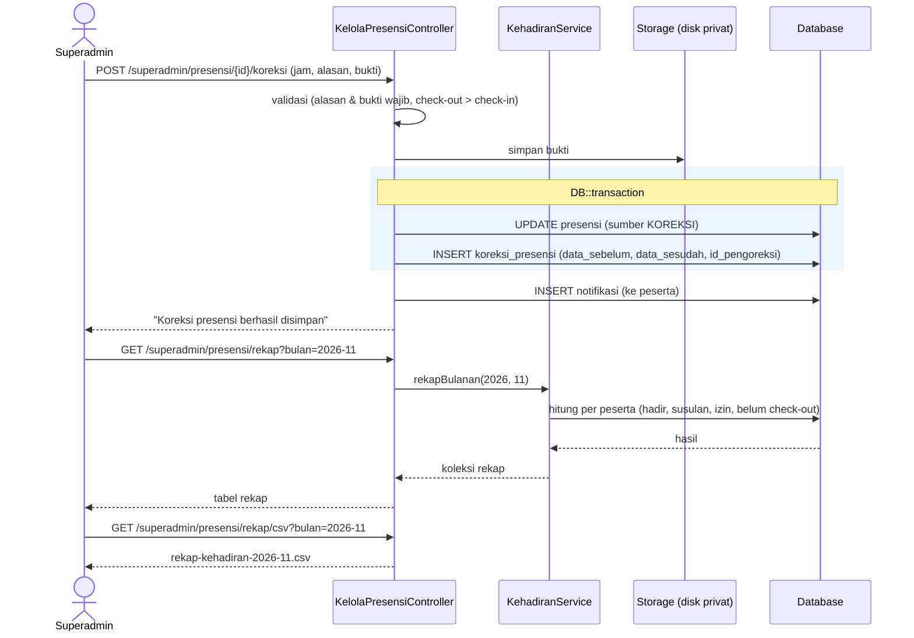

# Diagram Modul D — Presensi, Izin, Rekap Kehadiran

Diagram ditulis dalam **Mermaid** (GitHub menampilkannya otomatis). Versi gambar SVG untuk dokumen ada di folder [`img/`](img/).
Isi diagram mengikuti implementasi di branch ini (controller, service, tabel, dan pesan galat).

| Kode | Use case | Aktor |
|---|---|---|
| UC-08 | Melakukan Presensi Reguler | Peserta Magang |
| UC-09 | Mengajukan dan Memverifikasi Presensi Susulan | Peserta Magang, Mentor DTI |
| UC-10 | Mengoreksi dan Merekap Presensi | Superadmin |
| UC-11 | Mengajukan dan Memverifikasi Izin | Peserta Magang, Mentor DTI |

---

## 1. Use Case Diagram Modul D

---

## 2. Activity Diagram

### 2.1 UC-08 Presensi Reguler (Check-in & Check-out)

### 2.2 UC-09 Presensi Susulan

### 2.3 UC-11 Pengajuan & Persetujuan Izin

### 2.4 UC-10 Koreksi & Rekap Presensi

---

## 3. Sequence Diagram

### 3.1 UC-08 Check-in

### 3.2 UC-09 Presensi Susulan

### 3.3 UC-11 Izin

### 3.4 UC-10 Koreksi & Rekap

